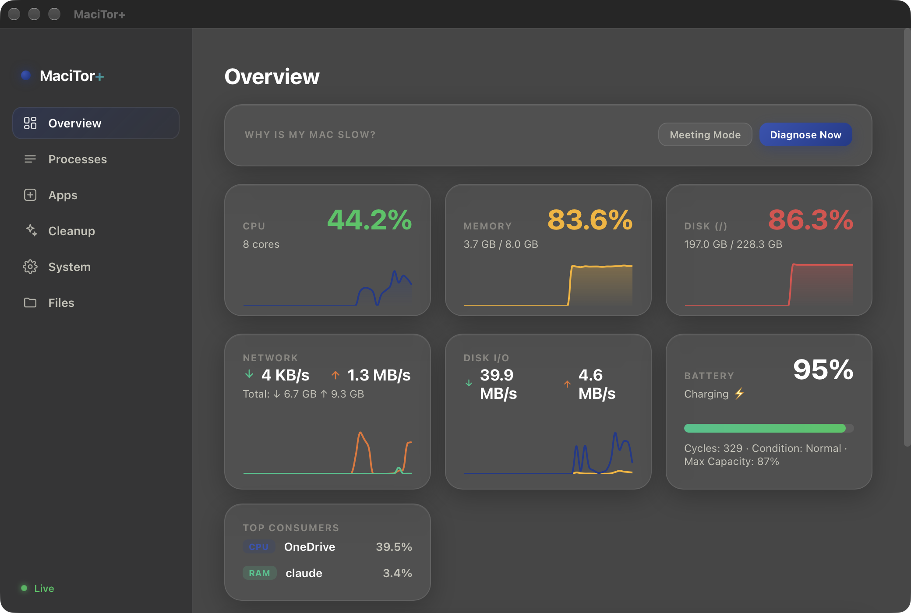

<div align="center">

# MaciTor+

**A native-feeling macOS system monitor, cleanup, and uninstaller app.**

Built with Python and [pywebview](https://pywebview.flowrl.com/) — a glassmorphism HTML/CSS/JS
interface rendered in a native `WKWebView`, with real macOS vibrancy and no Electron overhead.

[](#requirements)
[](#requirements)
[](LICENSE)



</div>

## Why

macOS ships no single place to see live system health, clean up safely, fully uninstall an app
(including its leftover cache/support files), *and* get a plain-language answer to "why is my Mac
slow right now" — with one-click fixes attached. MaciTor+ is that single place, built to be fast,
local-only, and transparent about every action it takes (everything destructive moves to Trash,
nothing is deleted permanently without confirmation).

## Features

| Tab | What it does |
|---|---|
| **Overview** | Live CPU, memory, disk, network, disk I/O, battery, and per-core usage with rolling sparkline charts. Surfaces the top CPU/RAM consumers and a plain-language **"Why is my Mac slow?"** diagnosis with one-click fixes (force-restart the offending app, reboot, open Cleanup). |
| **Meeting Mode** | One click quits background sync apps (OneDrive, Dropbox, Google Drive, Creative Cloud, …) and purges inactive memory before you share your screen — never touches Teams/Zoom/communication apps. |
| **Processes** | Search, stop, or **force-restart** (kill every subprocess under the app bundle + relaunch) any running app — built for apps like GlobalProtect that hang and eat CPU for hours. |
| **Apps** | A real uninstaller: finds an app's related cache, preference, log, and support files (by bundle ID), shows you what it found, and moves everything to Trash on confirmation — never silently fails on a locked file, and stops the app's processes/LaunchAgents first. |
| **Cleanup** | One-click **Deep Clean** (user caches + `brew cleanup` + `podman system prune` + DNS flush, reports space freed), a visual disk breakdown by category, largest folders, and quick actions (restart Finder/Dock, flush DNS, prevent sleep, restart/sleep the Mac). |
| **Files** | Screenshot cleanup, a duplicate-file finder (skips `node_modules`/`venv`/`.git`/build folders so it never touches your projects), Mail/Messages attachment size, and a per-browser cache breakdown (Safari/Chrome/Firefox/Edge/Arc). |
| **System** | Device info, FileVault/Gatekeeper/Firewall status, Wi-Fi/IP, login items (including toggling MaciTor+ itself), Homebrew & macOS Software Update checks with one-click update, a VPN/Avast conflict warning, Time Machine status, and Podman machine/container controls. |

## Design

- Real native vibrancy (`NSVisualEffectView`) behind a transparent `WKWebView`, with CSS
  `backdrop-filter` glass cards on top — not a flat-color fake.
- Every destructive action (uninstall, duplicate cleanup, cache clearing) moves files to
  **Trash**, never deletes permanently, and shows exactly what it's about to touch before doing it.
- No telemetry, no network calls except the ones you trigger yourself (Homebrew/macOS update
  checks).

## Requirements

- macOS 11+
- Python 3.10+
- [Homebrew](https://brew.sh) (optional — only needed for the Homebrew-related cleanup/update actions)

## Setup

```bash
git clone https://github.com/kaan4dev/macitor-plus.git
cd macitor-plus
python3 -m venv venv
source venv/bin/activate
pip install -r requirements.txt
python main.py
```

## Packaging as a `.app`

MaciTor+ can be wrapped in a minimal `.app` bundle — no Xcode required — so it shows up in
Launchpad and Applications like any other native app:

```
MaciTor+.app/
  Contents/
    Info.plist              # CFBundleExecutable -> launcher, CFBundleIconFile -> AppIcon
    MacOS/launcher           # shell script: exec venv/bin/python main.py
    Resources/AppIcon.icns
```

Build an `.icns` from a 1024×1024 PNG with the built-in `sips` + `iconutil` tools, then point
`Info.plist`'s `CFBundleIconFile` at it.

## Project structure

```
main.py              # pywebview window + Api class exposed to JS (all system calls live here)
web/
  index.html          # layout
  style.css            # design tokens, glassmorphism cards, components
  app.js               # UI logic, polling loops, Chart.js sparklines
  vendor/chart.umd.min.js
```

## Contributing

Issues and PRs are welcome. This is a personal-utility project first, so please keep additions
focused on "useful, local, no telemetry, no risky defaults."

## License

MIT — see [LICENSE](LICENSE).
